# AMLOpcUa user manual

AMLOpcUa is a plugin for the AutomationML Editor that brings OPC UA
information models into AML documents. With it you import NodeSets as AML
libraries, create and check instances of their types, connect to running
servers and take their nodes and values into the document, serve a document
as an OPC UA server, draw and edit models, and write a document or a model
back out as a NodeSet.

This manual says what to do in the plugin, step by step. It is written for
engineers who know AutomationML and, roughly, OPC UA; it does not explain how
the plugin is built. The reference documents beside it explain the mappings
and rules behind each step, and every chapter names the one that belongs to
it. The manual describes version 0.2.0; the [changelog](../CHANGELOG.md) lists
what changed between versions.

## Contents

1. [Installing](#installing):
   [Requirements](#requirements) ·
   [Installing a release](#installing-a-release) ·
   [Installing a build of your own](#installing-a-build-of-your-own) ·
   [Updating and removing](#updating-and-removing)
2. [The plugin at a glance](#the-plugin-at-a-glance):
   [The tabs](#the-tabs) ·
   [Status bar and log](#status-bar-and-log) ·
   [Tutorial and help](#tutorial-and-help) ·
   [Undo and saving](#undo-and-saving)
3. [Bringing OPC UA models into a document](#bringing-opc-ua-models-into-a-document):
   [Import a NodeSet file](#import-a-nodeset-file) ·
   [Drop files on the plugin](#drop-files-on-the-plugin) ·
   [Required models and NodeSet folders](#required-models-and-nodeset-folders) ·
   [Companion specifications](#companion-specifications) ·
   [UA Cloud Library](#ua-cloud-library) ·
   [ModelDesign files](#modeldesign-files) ·
   [Documents that reference the AutomationML base libraries](#documents-that-reference-the-automationml-base-libraries) ·
   [Importing a newer version of a model](#importing-a-newer-version-of-a-model) ·
   [The details of a namespace](#the-details-of-a-namespace) ·
   [Removing a namespace](#removing-a-namespace) ·
   [The Settings menu](#the-settings-menu)
4. [Instances of UA types](#instances-of-ua-types):
   [Create an instance](#create-an-instance) ·
   [What an instance contains](#what-an-instance-contains) ·
   [After a newer version of the types](#after-a-newer-version-of-the-types)
5. [Checking instances](#checking-instances)
6. [Working with a running server](#working-with-a-running-server):
   [Connect](#connect) ·
   [Browse the address space](#browse-the-address-space) ·
   [Import the server's types](#import-the-servers-types) ·
   [Take nodes into the document](#take-nodes-into-the-document) ·
   [Take the same part again](#take-the-same-part-again) ·
   [Bind a node to an element](#bind-a-node-to-an-element) ·
   [Read, keep and watch values](#read-keep-and-watch-values) ·
   [A plant to practise on](#a-plant-to-practise-on)
7. [Serving the document as an OPC UA server](#serving-the-document-as-an-opc-ua-server)
8. [Passing a document on](#passing-a-document-on)
9. [Diagrams](#diagrams)
10. [The Modeler tab](#the-modeler-tab):
    [Edit a model of the document](#edit-a-model-of-the-document) ·
    [Start a new model](#start-a-new-model) ·
    [Apply the model to the document](#apply-the-model-to-the-document) ·
    [Save and unapplied changes](#save-and-unapplied-changes)
11. [Exporting as a NodeSet](#exporting-as-a-nodeset)
12. [CAEX 2.15 documents](#caex-215-documents)
13. [Linking VDI 3682 process descriptions](#linking-vdi-3682-process-descriptions)
14. [The command line tool uaaml](#the-command-line-tool-uaaml)
15. [Language](#language)
16. [Where the plugin keeps its files](#where-the-plugin-keeps-its-files)
17. [Troubleshooting](#troubleshooting)

## Installing

### Requirements

- Windows and the AutomationML Editor 6.4 or later. The package declares
  6.4.0.0 as the lowest editor version it runs in.
- Documents in CAEX 3.0 (AutomationML 2.10). The OPC UA libraries of
  OPC 10000-83 Annex A use CAEX 3.0 features; a CAEX 2.15 document can be
  copied into CAEX 3.0 by the plugin (see [CAEX 2.15 documents](#caex-215-documents)).
- For the **Modeler** tab: the Microsoft Edge WebView2 Runtime. Most Windows
  installations have it; when it is missing, the tab says so (see
  [Troubleshooting](#the-modeler-tab-stays-empty)).
- A connection to the internet only for **Companion specs…**, **Cloud
  Library…**, **Publish…** and for fetching models an import cannot find. The
  UA Cloud Library needs an account of uacloudlibrary.opcfoundation.org or an
  API key; the OPC Foundation's published NodeSets need none.
- Optional: the OPC Foundation's ModelCompiler, only for importing ModelDesign
  files (see [ModelDesign files](#modeldesign-files)).

The package brings everything else along: the conversion (Opc2Aml), the OPC UA
stack, the graphical modeler, and the NodeSets of the UA base model (1.05.07)
and of Device Integration, DI (1.05.0).

### Installing a release

The plugin is on nuget.org as `Aml.Editor.Plugin.OpcUa`; the PlugIn Manager
lists it under its source PublicSource.

1. Close every other window of the AutomationML Editor. An installation or
   update while a second editor runs can remain incomplete.
2. In the editor, open the PlugIn Manager, choose the source
   **PublicSource**, select **AMLOpcUa** among the available plugins and
   install it.
3. Restart the editor and switch the plugin on once with **PlugIns** ›
   **AMLOpcUa** › **Activate**. It opens as the tab AMLOpcUa. Its first tab,
   **Namespaces**, shows the OPC UA models of the open document.

Without a network (a booth or a plant network), install the same package
from a folder:

1. Download `Aml.Editor.Plugin.OpcUa.<version>.nupkg` from the releases of the
   repository, <https://github.com/hsu-aut/AMLOpcUa/releases>. Leave the file
   packed. Take 0.1.1 or later: the package of 0.1.0 lacks the modeler.
2. Put the file into a folder of its own, for example `C:\AMLPlugins`.
3. In the PlugIn Manager, add the folder as a package source, select
   AMLOpcUa among the available plugins and install it, then go on as above.
   No network is needed: the package asks for nothing the editor does not
   bring.

When the editor shows no plugin at all after an installation, the PlugIn
Manager lists a plugin whose folder is gone (an update left half done):
uninstall that one in the PlugIn Manager and restart the editor.

### Installing a build of your own

A build of the repository (see [README](../README.md#build); it needs the
.NET 8 SDK and the modeler NodeSet.js built beside the repository) leaves its
package in `build/Plugins/Aml.Editor.Plugin.OpcUa/<configuration>/`. Add that
folder as a package source in the PlugIn Manager and install from there.

Do not copy files into an installed plugin folder by hand, and above all not
`Aml.Editor.Plugin.Contract.dll`: when the editor finds a second copy of it,
it ignores the plugin without a message.

### Updating and removing

A newer version is installed the same way, through the PlugIn Manager.
Settings, caches, certificates and applied models live outside the plugin
folder (see [Where the plugin keeps its files](#where-the-plugin-keeps-its-files))
and stay across updates. Uninstalling in the PlugIn Manager leaves these
folders in place; delete them by hand if you no longer need them.

## The plugin at a glance

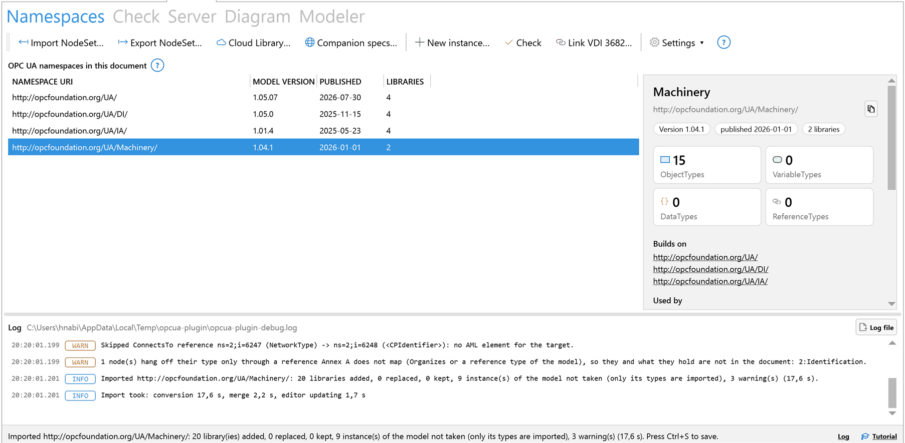

### The tabs

| Tab | What it is for |
|---|---|
| **Namespaces** | The OPC UA models in the document: import NodeSets, get companion specifications, the UA Cloud Library, new instances, check, export, links to VDI 3682, settings. The log sits in its lower part. |
| **Check** | The findings of the check of instances against their UA types, and adding Mandatory children after a type change. |
| **Server** | A running OPC UA server: connect, browse, take its types and nodes into the document, bind nodes to elements, read and follow values; and serving this document as a server of its own. |
| **Diagram** | A UA type or an instance drawn in the notation of OPC 10000-3, saved as SVG. |
| **Modeler** | The graphical modeler NodeSet.js: edit a model of the document or a new one and apply it to the document. |

The colour of a toolbar icon tells the kind of command: blue exchanges models
(import, export, values), green creates, orange checks, purple links, grey is
housekeeping.

A CAEX 3.0 document without OPC UA shows first steps instead of the namespace
list, under "Bring OPC UA into this document": **Import a NodeSet**, **Get a
companion specification**, **Connect to a server**, **Take the tutorial** and
**Model a new information model**. Each card leads to the command or tab of
the same purpose.

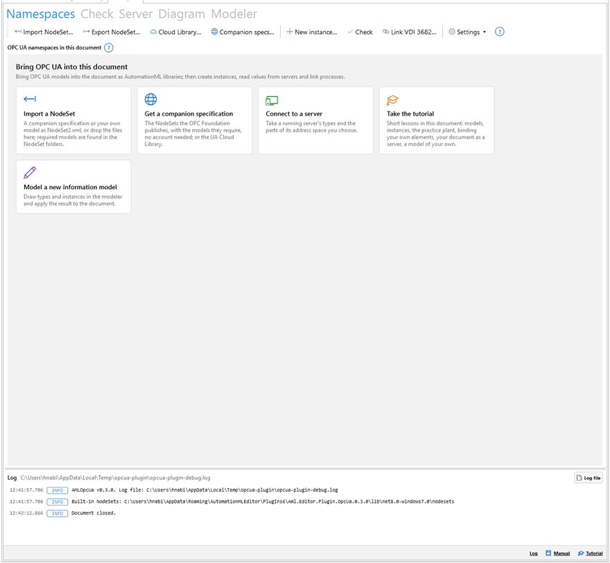

The plugin follows the editor's theme, light or dark, also when it changes
while the plugin is open. Diagrams and the modeler's canvas stay white.

Closing the plugin's tab ends its session with a server, stops serving the
document and frees the port.

### Status bar and log

Below all tabs runs one status bar:

- a progress bar while the plugin works;
- the last message; when it is cut off, its tooltip holds the whole text;
- **Log**, which shows the log. When warnings or errors arrived that you have
  not seen, it reads "Log (n new problem(s))" with a warning sign; an error
  counts once, with its stack trace;
- **Tutorial**, which opens the lessons.

The log fills the lower part of the **Namespaces** tab. Every line has its
time, its level (INFO, WARN, ERROR, and DEBUG when the debug log is on) in
colour, and the message. A right click offers **Copy selected lines**, **Copy
all** and **Clear the view**. The path of the log file stands beside the
caption; **Log file** opens it. The view keeps the last 1000 lines, the file
keeps everything (see [Reading the log](#reading-the-log)).

### Tutorial and help

**Tutorial** in the status bar, or the card **Take the tutorial**, opens a
panel at the right edge with four short lessons:

1. Models into the document: import DI, look at what it brings, draw a type.
2. Instances and checks: create an instance of a DI type and check it.
3. A running server: serve the document, connect to it, take a part of it
   back, keep its values live. No plant is needed.
4. A model of your own: a small model in the modeler, applied to the document.

The lessons work in the open document, which should be a new, empty one; the
first step offers **Save a practice document…** for that. Each step says what
to do and frames the control it is about in orange. It ticks itself off when
the plugin's state shows it done, for example when DI is among the
namespaces. **Show me** frames the control again, **Skip step** (or **Next**
where nothing can be observed) moves on, **All lessons** goes back to the
list. A lesson done gets a tick and can be started **Again**.

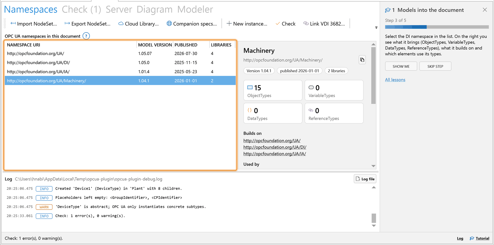

A **?** sits beside each part of the plugin: the namespace commands, the
namespace list, the **Check** tab, the connection, the server commands, "What
to take", "This document as a server", the **Diagram** tab and the **Modeler**
tab. It opens a short note on what the part does, with its terms to click for
an explanation, and a link "Show me in the tutorial" to the lesson that walks
through it.

### Undo and saving

The plugin writes into the document directly. **Ctrl+Z in the editor does not
take its changes back.** Save before larger steps. Commands that touch many
elements or remove some show what they do and ask first: adding Mandatory
children to every instance, removing a namespace, removing elements a server
no longer has, replacing a binding.

Save with Ctrl+S, as always. With **Settings ▾** › **Save after import** the
plugin triggers the editor's save command after each import and after **New
instance…**.

## Bringing OPC UA models into a document

An import converts a NodeSet by OPC 10000-83 Annex A, with Opc2Aml, the OPC
Foundation's reference implementation. For each UA namespace, of the NodeSet
and of every model it requires, the document gets four libraries:

| Library | Holds |
|---|---|
| `ATL_<namespace URI>` | DataTypes as AttributeTypes |
| `ICL_<namespace URI>` | ReferenceTypes as InterfaceClasses |
| `RCL_<namespace URI>` | InterfaceTypes as RoleClasses |
| `SUC_<namespace URI>` | ObjectTypes, VariableTypes and Methods as SystemUnitClasses |

together with the `OpcAmlMetaModel` libraries. Every class keeps the NodeId
of its UA node. An import takes the types only: objects and variables that a
NodeSet holds as instances are not merged into the document. To bring a
model's instances in, open it in the **Modeler** tab and apply it (see
[Apply the model to the document](#apply-the-model-to-the-document)). The
mapping in detail: [import](import.md).

### Import a NodeSet file

1. Open a CAEX 3.0 document.
2. On the **Namespaces** tab, click **Import NodeSet…**.
3. Choose the `NodeSet2.xml` file. The dialog starts in the folder you used
   last.
4. The conversion runs in the background; the progress bar shows it. The
   first conversion of a NodeSet takes from about ten seconds to a minute.
   The result is cached, so the same files take under a second the next time.
5. The status line sums up, for instance "Imported
   http://opcfoundation.org/UA/Machinery/: 8 library(ies) added, 0 replaced,
   4 kept (14.2 s)." The log repeats the summary, lists every warning, and
   says how long conversion, merge and the editor's update took; with the
   debug log on, it also lists each library added, replaced or kept.
6. Save the document with Ctrl+S.


One import runs at a time; a second one started meanwhile is told to wait. If
the document is closed or another is opened while a NodeSet is converted,
nothing is merged.

The plugin brings the UA base model and DI along, in the folder `nodesets`
of the installed plugin; the tutorial's first lesson imports DI from there.

### Drop files on the plugin

Drag one or more NodeSet files (`.xml`) from the Explorer onto the plugin. A
frame "Drop NodeSet files to import" appears; on dropping, each file is
imported in turn, with the models it requires. A file that is not a NodeSet
is named in the status line and skipped. The plugin takes a drop only when the
document is CAEX 3.0 and no other command runs.

### Required models and NodeSet folders

Every model a NodeSet requires, directly or through other models, must be
available as a file. The plugin looks, in this order:

1. in the folder of the imported NodeSet;
2. in the NodeSet folders (**Settings ▾** › **NodeSet folders…**);
3. in its own folders: models applied from the modeler, and NodeSets fetched
   from the OPC Foundation, the UA Cloud Library and servers;
4. in the NodeSets it brings along (UA base model and DI).

When two files declare the same model, the newer publication wins; a newer
copy of UA or DI in a NodeSet folder is used instead of the bundled one.

The dialog **NodeSet folders** lists the folders; **Add…** and **Remove**
change the list, **OK** keeps it.

Before converting, the plugin checks that every required model is there. If
one is not, the dialog **Models missing** names the missing models with their
versions and offers:

- **From the OPC Foundation**: fetches them from the NodeSets the OPC
  Foundation publishes, without an account;
- **Add NodeSet folder…**: adds a folder that holds them;
- **Search the Cloud Library…**: one search in the UA Cloud Library per
  missing model;
- **Cancel**: no import.

After the first three, the import checks again and goes on.

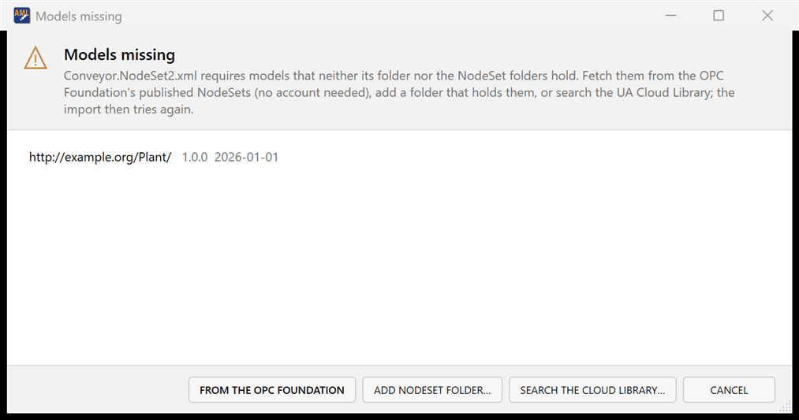

### Companion specifications

The OPC Foundation publishes the NodeSets of every released companion
specification at github.com/OPCFoundation/UA-Nodeset. The plugin imports them
without an account:

1. Click **Companion specs…** (or the card **Get a companion specification**).
2. The dialog **Companion specifications** reads the list. It asks GitHub at
   most once a day and keeps the list on disk; **Refresh list** asks now.
3. Type a name or a namespace, for example Machinery or Robotics.
4. Select a model and click **Download and import** (or double click it). The
   plugin downloads it with every model it requires that is not yet
   available, and imports it.

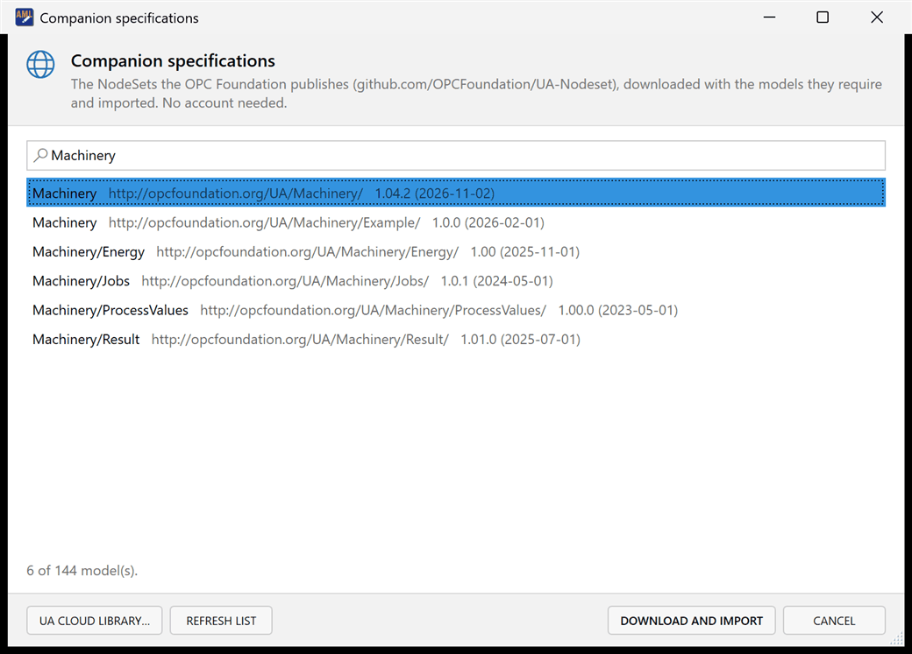

When GitHub cannot be reached, or its hourly limit for requests without a
login is spent, the list kept on disk still serves. **UA Cloud Library…**
switches to the Cloud Library for models of other publishers.

### UA Cloud Library

The OPC Foundation's UA Cloud Library also holds models of other publishers.
It needs an account or an API key.

1. Click **Cloud Library…**.
2. Enter **User** and **Password**, or an API key in **or API key**.
3. Enter keywords, or `*` for all, and click **Search**.
4. Select a model and click **Download and import**.

The model and every required model the plugin lacks are downloaded and
imported. The user name is remembered; the password and the API key are kept
for the editor session only and are never written anywhere.

### ModelDesign files

A ModelDesign file is the form in which the OPC Foundation writes its models
before they become NodeSets. Choose one in **Import NodeSet…** or drop it on
the plugin: the plugin recognises it, has the OPC Foundation's ModelCompiler
turn it into a NodeSet, and imports that NodeSet like any other.

The ModelCompiler is not part of the plugin. Install it with

```bash
dotnet tool install --global OPCFoundation.Opc.Ua.ModelCompiler.Tool
```

The plugin finds it in `%USERPROFILE%\.dotnet\tools`, on the PATH, or where
the environment variable `AMLOPCUA_MODELCOMPILER` names it. Without it, the
status line says how to get it. The other direction, a model written as a
ModelDesign, is **ModelDesign…** in the details of a namespace. Background:
[ModelDesign](modeldesign.md).

### Documents that reference the AutomationML base libraries

A document the AutomationML Editor creates gets the AutomationML base
libraries through an ExternalReference (for instance
`AutomationML_Base_Libraries_AMLEd2_2.11.0.aml`). The import keeps that
reference: the imported classes point at the referenced library, and no second
copy of the base libraries is added. This works when the referenced file can
be found: a relative path is resolved against the folder of the document, so
save a new document before the first import. If the file is not found or lacks
a class the import needs, the import adds its own copy, and the report names
the missing classes.

### Importing a newer version of a model

Importing a namespace again replaces its libraries in place. The IDs stay the
same, so references into the libraries remain valid. A newer model is never
replaced by an older one: the document's newer copy is kept, and the log warns
about it. With **Settings ▾** › **Replace existing libraries** switched off,
libraries the document already has are kept in any case.

Instances made from the older version may now lack Mandatory children; see
[After a newer version of the types](#after-a-newer-version-of-the-types).

### The details of a namespace

The list "OPC UA namespaces in this document" shows each namespace with
**Namespace URI**, **Model version**, **Published** and the number of
**Libraries**. A right click offers **Edit in the modeler** and **Copy
namespace URI**.

Select a namespace to see its details on the right:

- its short name, its URI (with a button to copy it), version, publication
  date and number of libraries;
- how many ObjectTypes, VariableTypes, DataTypes and ReferenceTypes it brings;
- **Builds on** and **Used by**: the namespaces it needs and those that need
  it; a click on one selects it;
- **In this document**: how many elements of the instance hierarchies use its
  types;
- **Types**: its types with a search box; a double click or Enter draws a
  type on the **Diagram** tab;
- the actions below.

| Action | What it does |
|---|---|
| **Edit in the modeler** | Opens the NodeSet of the namespace in the **Modeler** tab (see [The Modeler tab](#the-modeler-tab)). |
| **Documentation…** | Writes one HTML page of the model and opens it: its types with their declarations and diagrams, its DataTypes and ReferenceTypes, and for each state machine type its states and transitions as tables and as a state chart. The page needs no other files. |
| **ModelDesign…** | Writes the model as a ModelDesign file, with its identifier file (`.csv`) beside it, the form the OPC Foundation's ModelCompiler reads. The model is taken from the document itself, so the design holds what the document holds now. |
| **Publish…** | Publishes the model's NodeSet to the UA Cloud Library (see below). |
| **Remove…** | Removes the namespace's libraries (see [Removing a namespace](#removing-a-namespace)). |

**Publish…** sends the NodeSet file the namespace was imported from. The
plugin keeps a copy of every NodeSet imported from a folder it does not
search, so the file is found wherever it came from. The dialog
"Publish to the UA Cloud Library" asks for **Title**, **Description**,
**Copyright**, **License** (MIT, ApacheLicense20 or Custom), optional
**Keywords** and **Documentation URL**, and the account. **Replace my earlier
upload of this model** replaces an earlier upload. For a namespace of the OPC
Foundation the dialog warns to publish only models you own. **Publish…** asks
once more before anything is sent. The OPC Foundation reviews an upload
before it is listed.

### Removing a namespace

**Remove…** in the details of a namespace removes its four libraries. It is
available only when no other namespace builds on it and no element uses its
types; otherwise its tooltip names what still needs it. The plugin asks
before it removes. Ctrl+Z does not bring the libraries back; importing the
NodeSet again does.

### The Settings menu

**Settings ▾** on the **Namespaces** toolbar holds:

| Entry | What it does |
|---|---|
| **NodeSet folders…** | The folders searched for required models. |
| **Replace existing libraries** | Replace OPC UA libraries the document already has on a new import (on by default). An older model never replaces a newer one. |
| **Save after import** | Trigger the editor's save command after an import and after **New instance…** (off by default). |
| **Debug log** | Write detailed lines (DEBUG) to the log. |
| **Language** | The plugin's language: as Windows, English or Deutsch; from the next start of the editor. |
| **Forget earlier conversions** | Empty the cache of conversions; the next import converts again. |
| **Forget fetched NodeSets…** | Delete the NodeSets fetched from servers, the OPC Foundation and the Cloud Library. They are fetched again when needed. Models applied from the modeler stay, and the document does not change. The plugin asks first and says how many files and megabytes it deletes. |

## Instances of UA types

An instance is created the way an OPC UA server creates one: every Mandatory
child of the type, the Optional children you choose, and for each placeholder
the children you name. Background: [instances and checks](instances.md).

### Create an instance

1. Import the model that holds the type.
2. On the **Namespaces** tab, click **New instance…**. The dialog "New OPC UA
   instance" opens.
3. On the left under **Type**, search for the type by name and select it. The
   list shows each type with its namespace. Abstract types are hidden unless
   **Show abstract types** is ticked. Enter in the search box takes the first
   type found and moves on to the name.
4. Under **Name**, enter the name of the instance. The plugin proposes the
   type's name without "Type".
5. Under **Instance hierarchy (created if new)**, choose an InstanceHierarchy
   or type the name of a new one. Without any, the plugin proposes
   `OpcUaInstances`.
6. Under **Optional children to create**, tick the Optional children you want.
   An Optional child below another Optional child can be ticked only once its
   parent is.
7. Under **Children for placeholders**, enter for each placeholder (a name in
   angle brackets, such as `<DeviceName>`) the names of the children to
   create, separated by commas, and choose their type: the declared type or
   one of its concrete subtypes. When the declared type is abstract, its first
   concrete subtype is preselected. A placeholder marked "(at least one)" is a
   MandatoryPlaceholder.
8. Click **Create**.

The line at the bottom of the dialog says how many Mandatory children are
always created. Before creating, the dialog says once when a
MandatoryPlaceholder is left empty or when the hierarchy already holds an
element of the same name; **Create** again goes ahead.

The instance is added at the end of the InstanceHierarchy and selected in the
editor. The status line says how many children it got; the log lists the
children created for placeholders and the placeholders left empty.

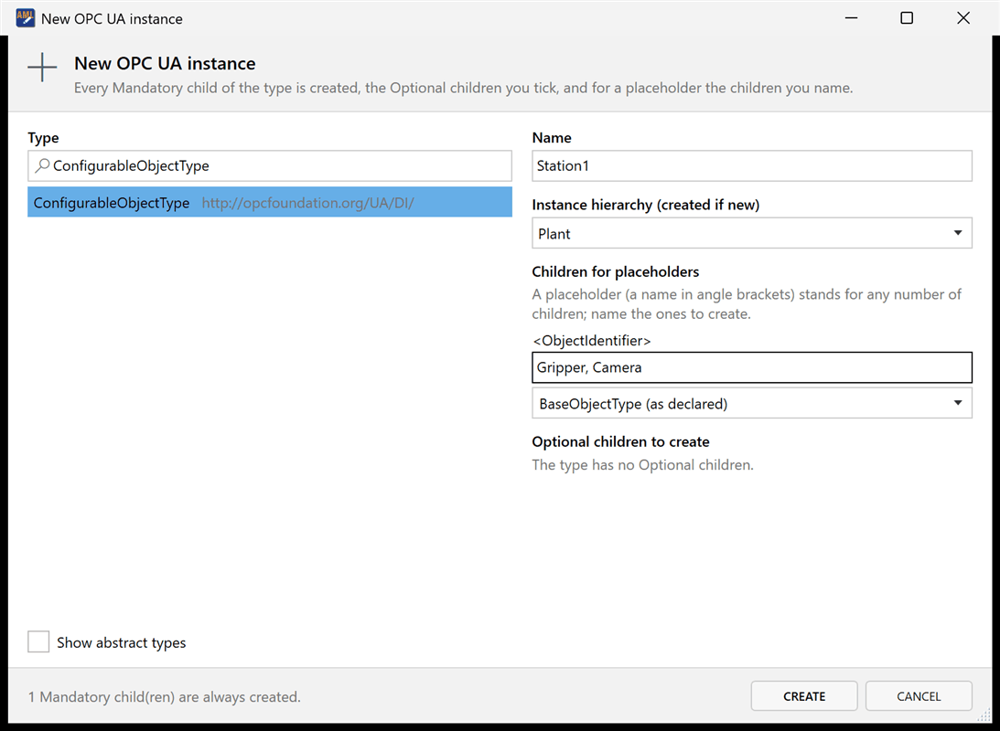

### What an instance contains

| ModellingRule of a child declaration | In the instance |
|---|---|
| Mandatory | always |
| Optional | only if ticked |
| MandatoryPlaceholder, OptionalPlaceholder | the children named for it, of the chosen type; none if no name is given |
| ExposesItsArray | none: how many there are is known only where the values are |

A child declared again in a subtype keeps what the supertype's declaration
holds below it, as OPC UA asks. What only makes sense on a type is left out of
the instance: `IsAbstract`, the root's `BrowseName`, every `NodeId` copied
from the type, and the `ModellingRule` on the interfaces.

An instance of an abstract type is created when you ask for one, with a note
in the dialog and the log; OPC UA itself instantiates only concrete subtypes,
and **Check** reports such an instance (UA002).

### After a newer version of the types

When a newer version of a companion specification is imported, its types may
declare Mandatory children that older instances lack.

1. Open the **Check** tab and click **Add missing Mandatory children**.
2. The plugin lists what it would add (the first 15 entries, and how many
   more) and asks.
3. Click **Add**. The children are added as a new instance would get them;
   nothing that exists changes. The check then runs again.

Ctrl+Z does not take the added children back.

## Checking instances

**Check** on the **Namespaces** toolbar, or **Check again** on the **Check**
tab, compares every element of the instance hierarchies with its UA type. The
generated libraries are not checked.

The **Check** tab opens with the result. Its header shows the number of
findings, for instance "Check (3)". The line above the list counts errors and
warnings and names the rules found. The list shows **Severity**, **Rule**,
**Element** and **Finding**. A double click on a finding, or Enter, selects
its element in the editor.

| Rule | Severity | Finding |
|---|---|---|
| UA001 | Error | The element refers to a UA type the document does not contain. |
| UA002 | Error | The element instantiates an abstract type. |
| UA003 | Error | A Mandatory child of the type, inherited ones included, is missing. |
| UA004 | Error | A MandatoryPlaceholder has no child of its type or a subtype. |
| UA005 | Error | An InternalLink points to an interface that does not exist. |
| UA006 | Error | An InternalLink connects reference interfaces that do not belong together (RefClassConnectsToPath, Annex A). |
| UA007 | Warning | An element named like a placeholder (`<Name>`) sits in an instance hierarchy. |
| UA008 | Warning | A VDI 3682 element links to an OPC UA element that does not exist. |

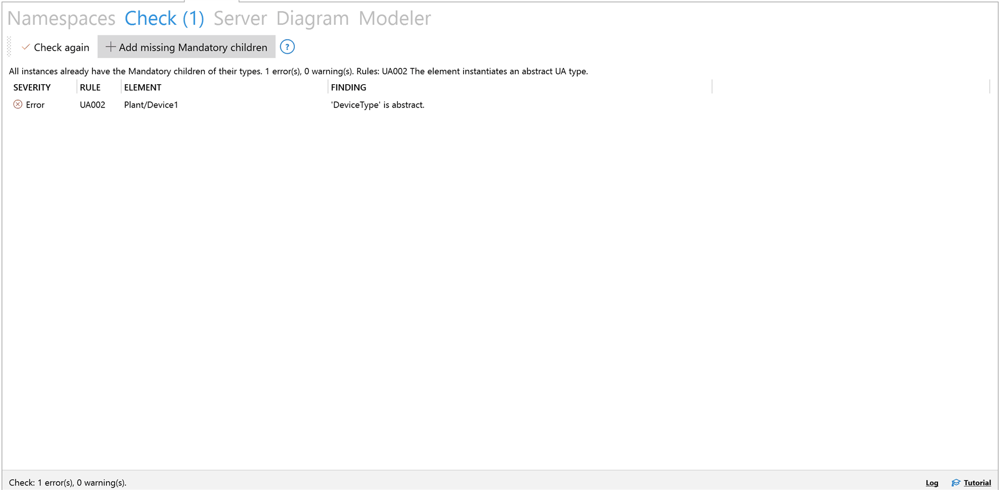

## Working with a running server

The **Server** tab is arranged by task, from top to bottom: the connection;
the commands (the server's types, taking nodes, binding, values, removing
server addresses); "What to take"; "This document as a server"; then the
server's address space with the details of the selected node and the parts
selected so far. Background: [servers](server.md).

### Connect

1. Enter the endpoint URL in the box at the top, for example
   `opc.tcp://plc:4840`. The list of the box holds the servers used recently.
2. For a user login, fill in **User** and **Password**; leave both empty to
   connect anonymously. In a narrow pane they stand on a second line, below
   the endpoint URL.
3. Leave **Secure** ticked (the default) to connect only to a signed, or
   signed and encrypted, endpoint. A server that offers none is refused
   rather than used unsecured. Untick **Secure** to allow an unsecured
   endpoint. A user name and password are never sent over an unsecured
   connection.
4. Click **Connect**, or press Enter in the box.
5. The first time, a server's certificate is unknown. The dialog "Trust this
   server?" shows its subject, issuer, validity and SHA-256 fingerprint.
   Compare the fingerprint with the one the server's administrator gives you,
   then click **Trust this certificate**. Exactly this certificate is kept; a
   server that later shows another certificate is asked about again.

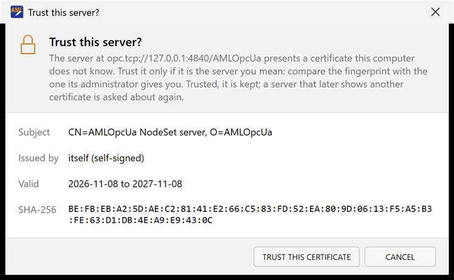

The field at the left of the connection band shows the state, for instance
"Connected · signed and encrypted, Basic256Sha256". The plugin asks the
server every five seconds; when it no longer answers, the field shows
"Connection lost". Then click **Disconnect**, and connect again once the
server is back.

The plugin creates its own client certificate. A server that admits only
known clients may need its administrator to trust that certificate before
the connection succeeds.

### Browse the address space

The tree on the left starts at the server's Objects folder; the server's
Views, if it has any, form a further root "Views". Expand a node to see its
children. Each node shows its node class by the shape of its icon (rectangle
Object, rounded Variable, ellipse Method). A ✓ marks nodes already taken
from this server into the hierarchy named under **nodes into**. F5 reloads
the tree.

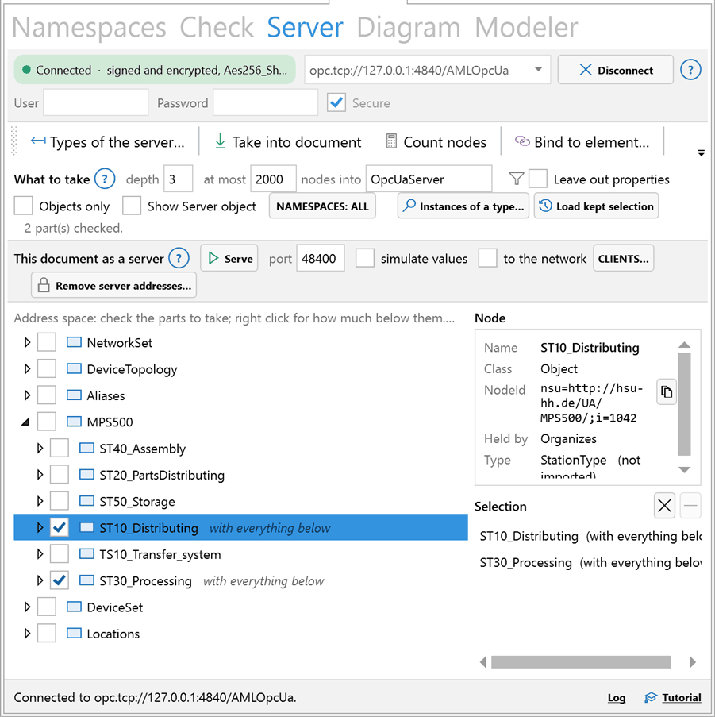

Selecting a node shows its details under **Node**: name, node class, NodeId
(with a button to copy it), BrowseName, the reference that holds it, its type
("not imported" when the document lacks the type's library), and for a
variable its current value and DataType. When the node is already in the
document, **Select** selects its element in the editor.

The filters in the band "What to take" apply to the tree as well:

- **Leave out properties**: no nodes held by HasProperty;
- **Objects only**: no variables;
- **Show Server object**: the Server object with the server's own diagnostics
  and capabilities, hidden by default;
- **Namespaces: all**: a list of the server's namespaces; only nodes of the
  ticked ones are taken, with what they hold. Nothing ticked takes all.

### Import the server's types

A node taken into the document gets its UA type as class only when the
document holds that type's library. Import the server's types first:

1. Click **Types of the server…**.
2. The dialog "Types of the server" lists the server's namespaces with
   **Version**, **Published**, and under **NodeSet** where the NodeSet comes
   from: "published file" when the server offers the NodeSet of the namespace
   as a file, "by browsing" when the plugin has to rebuild it from the
   server's types.
3. Select the namespace and click **Import types** (or double click it).
   **Open in modeler** opens the NodeSet in the **Modeler** tab instead,
   **Save as…** saves it as a file.

A published file is taken as it is if it is a NodeSet of that model alone and
at most 64 MB. A NodeSet rebuilt by browsing lacks what a server does not
expose: Documentation links, Category, SymbolicName, the type dictionaries,
and nodes that no reference leads to. Models the NodeSet requires that no
folder holds are fetched from the server the same way. **Include the
namespace's objects** adds the objects of the namespace, for the modeler or a
file; an import takes only the types, and the objects come in through **Take
into document**.

### Take nodes into the document

Every variable and property of a server becomes an element of its own; a DI
device alone gives 50 to 100 elements. So you choose what to take:

1. Tick nodes in the tree. A ticked node is taken with everything below it,
   down to the depth given. Space ticks the selected node. Methods cannot be
   ticked.
2. A right click on a node says how much to take: **Take the node only**,
   **Take it with its children**, **Take it with everything below**, **Do not
   take it**. **Leave it out of checked parts** excludes a node below a ticked
   one. **Instances of a type below it…** ticks every instance of a type.
3. **Instances of a type…** in the band "What to take" does the same below the
   selected node, or below Objects when none is selected: choose one of the
   server's ObjectTypes or VariableTypes, and the plugin lists the instances
   found, subtypes included, each to be taken with everything below it. Untick
   the ones to leave out.
4. The list **Selection** on the right shows the parts chosen. Its buttons
   remove the selected part or clear the selection. With nothing ticked,
   **Take into document** takes the selected node with everything below it.
5. Set the limits in the band "What to take":
   **depth**: the levels taken below a node taken with everything below it,
   0 for no limit but the node limit (default 3);
   **at most**: the number of nodes taken at once, against taking a whole
   server by accident (default 2000; the value is remembered);
   **nodes into**: the InstanceHierarchy that receives them (default
   `OpcUaServer`).
   A value outside its range is marked red and named when a command needs it.
6. **Count nodes** says how many elements the selection gives, without
   changing the document.
7. Click **Take into document**. While the selection is read, the status line
   counts the nodes found.

The nodes arrive below an element for the server, which carries the server's
`ServerUri` and `EndpointUrl`. The nodes on the way from the Objects (or a
View) folder down to each part become elements too. Every element carries its
NodeId (OPC 10000-83 Annex A) including the server's ApplicationUri, and its UA
type as class where the document holds the type's library. Variables get a
`Value` attribute with the current value and an XML Schema data type. The
editor then selects the server element, and the status line counts the nodes:
added, updated, typed by an imported UA type, linked to a planned element.

**Planned elements.** When the document already models a node, that is, an
element outside the receiving hierarchy carries the same NodeId, the element
taken from the server becomes an aspect of it: its attribute `refBaseObj`
(AutomationML object reference attribute types) holds the ID of the planned
element. The planned element does not change; the attribute library is added
to the document if it is missing. A node that several planned elements claim
is not linked, and a type that differs between server and plan is reported in
the log.

### Take the same part again

The selection is kept with what was taken, as the attribute `MirrorSelection`
of the server element. **Load kept selection** puts it back into the tree,
with its filters and depth, so the same part can be taken again.

When the hierarchy under **nodes into** already holds what was taken from this
server, **Take into document** asks, in the dialog "Take again":

- **Update it**: values and types are read again and new nodes are added.
  Choose what happens to elements whose node the server no longer has: "keep
  them, list them in the log", "keep them, mark them with NotOnServer" (the
  mark goes when the node is back), or "remove them from the document, after
  asking". Removing asks once more, naming the elements.
- **Take into a new InstanceHierarchy**: the earlier state stays as it is; the
  new hierarchy gets the name with `_2` (`_3` and so on) appended.

### Bind a node to an element

To give an element of your own model the address of a server node:

1. Select the node in the tree.
2. Click **Bind to element…**.
3. Search the element by name or path, select it and click **Bind**.

The element gets the node's address as its `NodeId` attribute (Annex A), with
the server's URI. When it is bound to another node already, the plugin shows
both addresses and asks before it replaces the binding. The editor then
selects the element.

### Read, keep and watch values

| Command | What it does |
|---|---|
| **Read values into document** | Reads the current value of every element bound to this server once and writes it into the document: every element with a `NodeId` and a `Value` attribute, and every AutomationML BPR 007 DataVariable. Elements bound to another server are skipped. |
| **Keep document values live** | The same bindings, subscribed: every change the server reports is written into the document until you click **Stop keeping values live**, disconnect, or close the document. The status line shows the last change. The document is not saved; Ctrl+S keeps the last values. |
| **Watch (view only)** | Shows the value of the selected variable in a list below the tree (**Node**, **Value**, **Status**, **Received**) as it changes. Nothing is written into the document. The button beside it stops watching and clears the list. |

A NodeId given as a browse path or an alias is resolved by the connected
server when values are read or kept live. How the conventions of addressing a
node from AML differ: [servers](server.md#addressing-a-node-from-aml).

### A plant to practise on

The plugin brings a plant to connect to: the MPS 500 learning factory of the
Helmut Schmidt University on DI, with stations, modules, devices and a state
machine per station ([examples/mps500](../examples/mps500/README.md)).
**Practice plant** beside **Connect** starts it as an OPC UA server on this
computer, with moving values, and puts its address into the endpoint box; it
takes the next free port when another server holds 4840. Clicking it again
stops it, and so does closing the editor.

1. Click **Practice plant**, then **Connect**, and trust its certificate.
2. **Types of the server…**, choose `http://hsu-hh.de/UA/MPS500/`, **Import
   types**.
3. Tick `MPS500` or one station, **Take into document**.
4. **Keep document values live**: spindle speeds and cycle times move in the
   document.

No network and no command line is needed. The command line tool serves the
same plant with `uaaml serve --nodeset examples/mps500/MPS500.NodeSet2.xml
--simulate`. The document itself can serve as a plant too (next chapter); the
tutorial's third lesson does that.

## Serving the document as an OPC UA server

The band "This document as a server" on the **Server** tab starts an OPC UA
server whose address space is the document's instance hierarchies. Clients can
then be tried against the engineering model before the plant exists.

1. Check the port under **port** (default 48400).
2. Tick **simulate values** if the values should move.
3. Tick **to the network** only if other computers must reach the server.
4. Click **Serve**.

The status line says how many nodes are served and where, for instance
"Serving 42 node(s) of this document at opc.tcp://127.0.0.1:48400/AMLOpcUa,
to this computer only." When the plugin is not connected to a server, that
endpoint is filled into the connection box, so **Connect** reaches the
document server at once (trust its certificate the first time). **Stop
serving** ends it; closing the document, opening another or closing the
plugin ends it too.


What is served:

- each InstanceHierarchy is a folder below Objects;
- elements become Objects, or Variables when their UA type is a VariableType
  or they carry a `Value` and no children;
- elements with an Annex A NodeId keep it; the others get a NodeId from their
  path in the namespace `urn:amlopcua:document`;
- values come from the `Value` attributes, typed by their AttributeDataType;
- nothing is writable and no method is offered.

The nodes are those of the document when serving starts. Their values follow
the document: a value changed in the editor reaches the served node after a
short pause, and subscribed clients see it. Added or removed elements need a
restart; the plugin says so once.

With **simulate values**, the served values move as a running plant's would:
every half second each number swings on a slow sine (30 seconds) around the
document's value, by a fifth of it (by 10 around zero); booleans toggle every
five seconds; texts stay. The document keeps its values; a value edited there
becomes the new middle.

**This computer only (default).** The server listens on 127.0.0.1, offers the
unsecured endpoint besides the secured ones and admits every client. Only
programs on this computer reach it.

**To the network.** The server listens on every address under the computer's
name, offers secured endpoints only (Basic256Sha256 and newer, Sign and
SignAndEncrypt), and admits only clients whose certificate you trusted. A
client it refused appears under **Clients…**: tick it to admit it from its
next connection, untick a trusted client to drop it. Anonymous sessions stay
allowed, so the client certificate is the whole access control. The tick
**to the network** is not kept: every editor session starts with the server
for this computer only.

## Passing a document on

A document with nodes taken from a server says where the server is: the
server element carries `EndpointUrl` and `ServerUri`, every NodeId below it a
`ServerInstanceUri` (which usually holds the host name), and a server element
after BPR 007 or DIN SPEC 16592 `EndpointURL` and `DiscoveryURL`. Before you
pass the document on:

1. On the **Server** tab, in the band "This document as a server", click
   **Remove server addresses…**. It needs no connection.
2. Choose where to save the copy; the plugin proposes
   `<name>-without-addresses.aml` beside the document.

The copy lacks these addresses; the open document stays as it is. What a node
is known by (namespace URI and identifier), links to planned elements, how a
server is secured, and the libraries all stay. A host name can also sit in a
value or a description; the log names every place where one still appears.
The plugin never writes credentials into a document.

## Diagrams

The **Diagram** tab draws a UA type or an instance of one in the notation of
OPC 10000-3. Background: [diagram](diagram.md).

1. Pick what to draw in the list: instances appear as "instance …", types as
   "type …". The search box before it filters the list; Enter takes the first
   entry. Picking an entry draws it. From the details of a namespace, a double
   click on a type draws it too.
2. **depth** sets the levels drawn (1 to 10, default 3); **Show** draws
   again. A picture is cut at 300 nodes, and the line below it says
   "truncated".
3. Zoom with the slider or Ctrl and the mouse wheel; **Fit** fits the picture
   into the view.
4. A click on a shape selects its element in the editor. A double click draws
   the shape's type; for a type, its supertype.
5. **Export SVG…** saves the picture as SVG.

For a type the diagram shows its instance declarations, inherited ones
included, as an instance of the type would hold them; for an instance, its
children.

| Shape or mark | Means |
|---|---|
| rectangle | Object |
| rounded rectangle | Variable |
| ellipse | Method |
| shaded shape | ObjectType or VariableType |
| one stroke across the line | HasComponent |
| two strokes across the line | HasProperty |
| two filled heads | HasTypeDefinition |
| two hollow heads (at the supertype) | HasSubtype |
| open head | other hierarchical reference |
| filled head | non-hierarchical reference |
| M, O, MP, OP, E | ModellingRule: Mandatory, Optional, MandatoryPlaceholder, OptionalPlaceholder, ExposesItsArray |

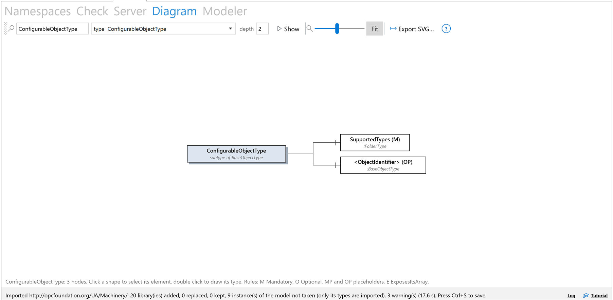

State machines are drawn as state charts in the page that
**Documentation…** writes, by `uaaml diagram --state-chart`, and in the
modeler while a machine is built; the **Diagram** tab draws the tree of what
a type holds.

## The Modeler tab

The **Modeler** tab holds the graphical modeler
[NodeSet.js](https://github.com/HamiedNabizada/NodeSet.js). It draws OPC UA
types and instances in the notation of OPC 10000-3 Annex C and edits NodeSet
files: types, instance declarations with ModellingRules, method arguments,
DataTypes, values, references and instances. It edits NodeSets, not the
document: the document gets the result through the same import as every other
NodeSet. Background: [modeler](modeler.md).

The modeler starts the first time the tab is shown. The plugin's toolbar
above it holds the list of the document's namespaces with **Edit**, a field
for a namespace URI with **New model**, **Open NodeSet file…** and a button
to reload the modeler. The modeler's own toolbar holds **Apply to document**,
**Save NodeSet**, **Undo**, **Redo**, **Model** and **Checks**.

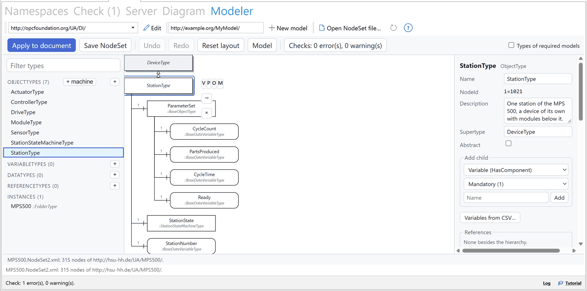

### Edit a model of the document

1. Choose the namespace in the list of the plugin's toolbar and click
   **Edit**, or click **Edit in the modeler** in the details of a namespace.
2. The plugin looks for the NodeSet file the namespace was imported from, in
   the modeler's models folder, its copies of imported NodeSets, the NodeSet
   folders, what it fetched from the OPC Foundation, the Cloud Library and
   servers, and the NodeSets it brings along, and opens it with every NodeSet
   it requires.

When the file is not found, the status line says so. This only happens for a
namespace imported before version 0.3.0 from a folder the plugin does not
search: import it again, or open the file with **Open NodeSet file…** (see
[Where the plugin keeps its files](#where-the-plugin-keeps-its-files)). The UA
base model is built into the modeler and is not edited there.

**Open NodeSet file…** opens any NodeSet file; the models it requires come
from its own folder and the NodeSet folders.

### Start a new model

1. Enter the namespace URI of the new model in the field (it proposes
   `http://example.org/MyModel/`) and click **New model**.
2. In the modeler, **+** beside a group of types (ObjectTypes, VariableTypes
   and the others) adds a type of that kind, **+ machine** beside ObjectTypes
   a state machine type; children are added from the context pad of a shape.
3. **Model** shows version, publication date and the models in use; there the
   model can load DI or another NodeSet file (**Load a NodeSet file…**) to
   build on.
4. **Checks** lists what the modeler finds wrong in the model.

### Apply the model to the document

Click **Apply to document** in the modeler's toolbar. The plugin keeps the
NodeSet in its models folder and imports it into the document like any
NodeSet: the libraries of the namespace are replaced unless the document holds
a newer publication. The modeler counts the model as unchanged only once the
import worked; a failed import reaches the modeler as a warning.

When the model holds instances, the dialog "Instances of the model" asks where
they go, every time:

- **Into 'IH_…'**, named after the last part of the namespace URI (for
  `http://example.org/MyPlant/` it reads **Into 'IH_MyPlant'**): an
  InstanceHierarchy of their own. Every Apply replaces it, with the same IDs;
  the rest of the document stays as it is.
- **Below '…'**, naming the element selected in the editor: the instances are
  added to what that element holds, with IDs of their own, on every Apply.
  Select an InstanceHierarchy or an element in the editor first; without a
  selection this choice is not available.
- **Not at all**: only the types are taken; the instances stay in the NodeSet.

**Take** follows the choice; **Types only** takes no instances.

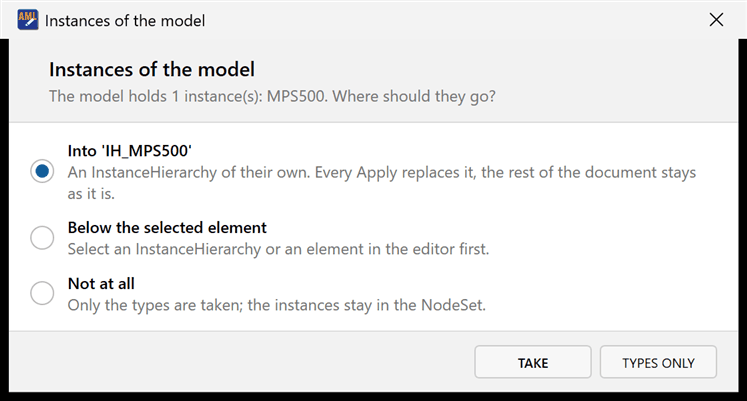

### Save and unapplied changes

**Save NodeSet** in the modeler's toolbar opens a save dialog of the plugin
and writes the NodeSet file.

"Modeler *" in the tab header means changes that are neither applied nor
saved. **Edit**, **New model**, **Open NodeSet file…**, reloading, and **Open
in modeler** from the server's types ask before they drop them. Changes in the
modeler's node editor that were not taken over yet (arguments, fields, a
structure value) are asked about before another node is selected, and before
Apply and Save. Diagram positions are kept in the NodeSet and survive the way
through the document.

The modeler also keeps an unsaved model in its own storage. When one is left
from an earlier session, it offers **Restore** or **Discard**.

## Exporting as a NodeSet

**Export NodeSet…** on the **Namespaces** toolbar writes a NodeSet. The
dialog "Export as OPC UA NodeSet" offers two modes:

- **The document**: instances, classes and libraries by the rules of the
  AutomationML/OPC Foundation working group (AML-UA-XSLT, the successor of
  OPC 30040), with documented deviations that fix evident errors of those
  rules. OPC UA models that the import put into the document come out as AML
  classes in UA, not as the UA nodes they were.
- **An imported OPC UA model, as it was**: the types, DataTypes,
  ReferenceTypes, methods and objects that Annex A put into the document,
  written back as UA nodes with their NodeIds. Choose the namespace in the list
  below it. This mode is not a standard; it is the inverse of Annex A. What
  Annex A leaves out, such as Documentation and type dictionaries, does not
  come back.

Click **Export…**, choose the file (the plugin proposes a name ending in
`.NodeSet2.xml`), and the status line says how many nodes it wrote. The export
works for CAEX 2.15 and CAEX 3.0 documents.

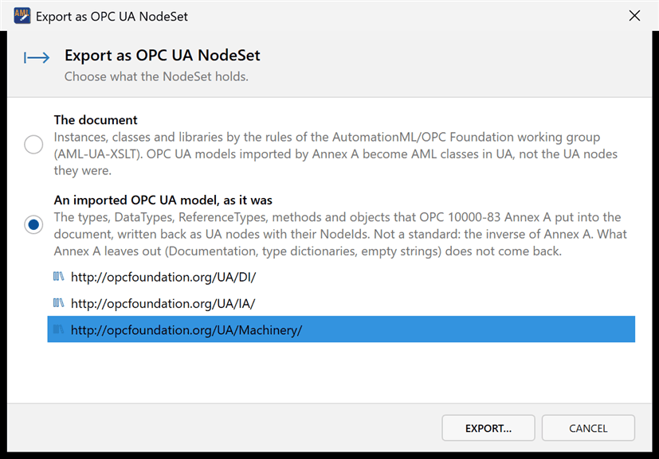

A tool that loads a NodeSet of the first mode needs two further NodeSets: the
AML base types (`Opc.Ua.AMLBaseTypes.NodeSet2.xml`) and the AutomationML
standard libraries (`Opc.Ua.AMLStandardLibraries.NodeSet2.xml`). Both lie in
the folder `nodesets` of the installed plugin.

Background: [export](export.md) for the rules and deviations,
[round trip](roundtrip.md) for what survives the way out and back. Options
such as a fixed publication date or output identical to the stylesheets are
available on the command line (`uaaml export`).

## CAEX 2.15 documents

The OPC UA libraries need CAEX 3.0. When the open document is CAEX 2.15, the
**Namespaces** tab says so, and **Import NodeSet…**, **Companion specs…**,
**Cloud Library…**, **New instance…** and **Link VDI 3682…** are not
available. **Export NodeSet…** works for CAEX 2.15 documents too.

1. Click **Save a CAEX 3.0 copy…**.
2. Choose where to save the copy; the plugin proposes `<name>_CAEX3.0.aml`.
   The conversion is Aml.Engine's own.
3. Open the copy in the editor and import there.

The editor does not let a plugin replace its open document, so the plugin
writes a copy. On the command line, `uaaml import --into` converts a CAEX 2.15
document on its own.

## Linking VDI 3682 process descriptions

A Formalised Process Description (VDI/VDE 3682) and an OPC UA model can live
in the same document: the process from the FPB plugin, the devices from an
OPC UA import or a running server. **Link VDI 3682…** connects them:

| From (VDI 3682) | To (OPC UA) | Attribute on the process element |
|---|---|---|
| TechnicalResource | the Object that represents the same resource | `refOpcUaObject` |
| ProcessOperator | the Method whose call executes the process | `refOpcUaMethod` |

1. Click **Link VDI 3682…** on the **Namespaces** toolbar.
2. Under **Relation**, choose "TechnicalResource to UA object" or
   "ProcessOperator to UA method".
3. Select the element under **VDI 3682 element** and its counterpart under
   **OPC UA element**, and click **Link**.
4. Repeat for further pairs; **Links in this document** lists them all.
   **Close** ends the dialog.

VDI 3682 elements are recognised by a class path or role ending in
`FPD_TechnicalResource` or `FPD_ProcessOperator`, as the FPB plugin writes
them; OPC UA elements are elements typed by an Annex A class. The attributes
are object references of the AutomationML object reference attribute types;
the first link adds their libraries to the document. **Check** reports a link
whose target is gone (UA008). Background: [VDI 3682](vdi3682.md).

## The command line tool uaaml

Most of what the plugin does can also be done without the editor, with the
command line tool `uaaml`, for scripts and tests. Only in the plugin: binding
a node to an element, keeping values live in a document, removing a
namespace, and taking a NodeSet's instances with **Apply**. The plugin
package brings the tool as its converter: `uaaml.exe` in the plugin's folder
`converter`, which runs on .NET 8 or newer. In the repository it is built
with the .NET SDK:

```bash
dotnet run --project dotnet/OpcUaAml.Tool -- help
```

`uaaml help` lists every command with its options. Connections to servers are
secured by default; `--insecure` allows an unsecured endpoint and `--accept`
trusts an unknown server certificate for one run. `--user <name>` logs in;
the password comes from the environment variable `AMLOPCUA_PASSWORD` or is
asked for, never given on the command line.

| Command | What it does | Background |
|---|---|---|
| `info` | Model, version and required models of a NodeSet, and which of them cannot be found | [import](import.md) |
| `import` | Converts a NodeSet by Annex A into a new document, or with `--into` into an existing one | [import](import.md) |
| `convert` | Converts a NodeSet by Annex A into a document of its own and describes the result beside it; the plugin converts this way | [import](import.md) |
| `types` | Lists the UA types of a document | [instances](instances.md) |
| `instantiate` | Creates an instance with its Mandatory, chosen Optional and placeholder children | [instances](instances.md) |
| `check` | Checks instances against their types | [instances](instances.md) |
| `upgrade` | Adds the Mandatory children that updated types now declare | [instances](instances.md) |
| `export` | Writes a document as NodeSet, or with `--annex-a-inverse` an imported model as it was | [export](export.md) |
| `browse` | Lists the children of a node of a running server | [servers](server.md) |
| `read` | Prints the current values of nodes, given by NodeId or by a path of BrowseNames | [servers](server.md) |
| `watch` | Prints the values of nodes as they change, until Ctrl+C | [servers](server.md) |
| `nodeset` | Lists a server's namespaces, or fetches and imports the NodeSet of one | [servers](server.md) |
| `mirror` | Takes nodes of a server into a document | [servers](server.md) |
| `snapshot` | Reads the current value of every bound element | [servers](server.md) |
| `serve` | Serves a document, or with `--nodeset` a NodeSet with its types, as an OPC UA server | [servers](server.md) |
| `clients` | Lists the clients the document server (with `--nodeset` the NodeSet server) refused or trusts, and trusts or drops one | [servers](server.md) |
| `strip-addresses` | Writes a copy of a document without server addresses | [servers](server.md) |
| `doc` | Writes the HTML documentation of an imported model | [README](../README.md) |
| `diagram` | Draws a type or an instance as SVG, with `--state-chart` a state machine | [diagram](diagram.md) |
| `link` | Links a VDI 3682 element to an OPC UA object or method | [VDI 3682](vdi3682.md) |
| `opcf` | Searches and downloads the NodeSets the OPC Foundation publishes | [import](import.md) |
| `cloud` | Searches, downloads and publishes models in the UA Cloud Library | [import](import.md) |
| `design` | Exports, compiles and imports ModelDesign files | [ModelDesign](modeldesign.md) |
| `roundtrip` | Sends models through both mappings and back and reports what survives | [round trip](roundtrip.md) |
| `compare` | Compares the class libraries of two documents, or two NodeSets as graphs | [round trip](roundtrip.md) |

`info` exits with 1 when a required model cannot be found, `check` when there
are errors, `compare` when the documents differ, `roundtrip` when a chain
breaks off.

## Language

The plugin speaks English or German, as the display language of Windows
says: German when it is German, English otherwise. The editor itself stays
English. To choose, use **Settings ▾** › **Language**: **As Windows**,
**English** or **Deutsch**; the choice applies from the next start of the
editor. The environment variable `AMLOPCUA_LANGUAGE` (`en` or `de`) comes
before that choice, for support. The modeler gets the same language.

OPC UA and AutomationML terms stay as the specifications name them in both
languages: NodeSet, NodeId, InstanceHierarchy, SystemUnitClass, ModellingRule.

Some texts stay English whatever the language: messages that come from the
OPC UA stack or from the conversion, the texts of the plugin's core (such as
the text of a finding on the **Check** tab and the warnings of an import),
most lines of the log, and the command line tool. The status line, the
dialogs and the import summary follow the plugin's language.

## Where the plugin keeps its files

| Folder or file | Holds |
|---|---|
| `%APPDATA%\AMLOpcUa\settings.json` | The settings: NodeSet folders, the options of the Settings menu, recent endpoints, the Cloud Library user name, the node limit, the lessons done. Never a password. |
| `%LOCALAPPDATA%\AMLOpcUa\conversions` | The cache of conversions (the last 40) |
| `%LOCALAPPDATA%\AMLOpcUa\opcfoundation` | The list and the files of the OPC Foundation's published NodeSets |
| `%LOCALAPPDATA%\AMLOpcUa\cloudlibrary` | Models downloaded from the UA Cloud Library |
| `%LOCALAPPDATA%\AMLOpcUa\server-nodesets\<server>` | NodeSets taken from servers |
| `%LOCALAPPDATA%\AMLOpcUa\models` | Models applied from the modeler |
| `%LOCALAPPDATA%\AMLOpcUa\pki` | The plugin's client certificate and the server certificates you trusted |
| `%LOCALAPPDATA%\AMLOpcUa\pki-server` | The certificate of the document server and the clients it trusts or refused |
| `%LOCALAPPDATA%\AMLOpcUa\WebView2` | The modeler's browser profile |
| `%TEMP%\opcua-plugin` | The log files |

The settings file also takes `ModelCompilerPath`, the path of a ModelCompiler
of your own, which has no field in the plugin. A settings file that cannot be
read is kept as `settings.json.unreadable`, and the plugin starts with its
defaults and a warning in the log.

## Troubleshooting

### Reading the log

Most questions are answered by the log: what an import did, which models were
missing, why a connection failed. Click **Log** in the status bar to see it.

- For more detail, switch on **Settings ▾** › **Debug log** and repeat the
  step. The setting is kept.
- **Log file** beside the log opens the file. It is
  `%TEMP%\opcua-plugin\opcua-plugin-debug.log`; a second editor running at the
  same time writes `opcua-plugin-debug.<process id>.log`. Beyond 5 MB the file
  is archived with a time stamp in its name and a new one begun.
- An error the plugin catches is written to the log with its details and
  shown in the status line as "Something went wrong: … The log has the
  details."; the editor goes on.

### "The PlugIn AMLOpcUa raised an exception!"

The editor shows this message when an error leaves the plugin. The plugin
catches the errors of its own commands, so the message points at a case it
did not foresee.

1. Save your work, under a new name if you are unsure the document is sound.
2. Open the plugin's log file (see above) and look for lines marked ERROR
   near the time of the message; they carry the error and where it happened.
   The editor keeps an error log of its own as well.
3. Switch on **Debug log**, repeat the step, and report it with the log file.

Up to version 0.1.3, opening or closing a document in the editor raised this
message; later versions fix that (see the [changelog](../CHANGELOG.md)).

### The plugin does not appear after installing

- Check that the editor is version 6.4 or later.
- Check that no file was copied into the installed plugin folder by hand, in
  particular no `Aml.Editor.Plugin.Contract.dll`: with a second copy of it the
  editor ignores the plugin without a message. Uninstall and install again
  through the PlugIn Manager.
- Close every other window of the editor and install again.

### Commands are greyed out

- **Import NodeSet…**, **Companion specs…**, **Cloud Library…**, **New
  instance…** and **Link VDI 3682…** need an open CAEX 3.0 document (see
  [CAEX 2.15 documents](#caex-215-documents)).
- All commands wait while the plugin works (the progress bar runs).
- On the **Server** tab most commands need a connection; **Watch (view
  only)** needs a variable selected; **Bind to element…** a node selected.
- **Save after import** is greyed when this editor version has no save
  command the plugin knows; its tooltip says so. Save with Ctrl+S.
- **Remove…** in the details of a namespace is greyed while something still
  needs the namespace; its tooltip names what.

### Imports are slow

The first conversion of a NodeSet converts the whole UA base model as well and
takes from about ten seconds to half a minute; it runs in a process of its
own (`converter\uaaml.exe` in the plugin folder), so the editor stays usable.
The same files again come from the cache in under a second. Merging the
result into the document takes a few seconds. The log line "Import took:
conversion …, merge …, editor updating …" says where the time went; "(cache)"
marks a conversion taken from the cache. **Forget earlier conversions** empties
the cache, so only use it when a conversion seems wrong.

Up to version 0.1.3 an import inside the editor could take many minutes or
not end at all, and importing a model again cleared the types of the
instances typed by it. Later versions fix both; update if you see either.

### Required models are missing

The dialog **Models missing** offers three ways; the first,
**From the OPC Foundation**, covers every released companion specification. If
a model is published neither there nor in the Cloud Library, get its NodeSet
file from its publisher, put it into a folder and add that folder under
**NodeSet folders…**. The log names the models the OPC Foundation does not
publish.

### The Modeler tab stays empty

The status line below the modeler says why:

- "The WebView2 runtime is missing or failed to start": install the Microsoft
  Edge WebView2 Runtime, then open the tab again; the plugin tries again each
  time the tab is shown.
- "The modeler is missing from the plugin folder": the package lacks the
  modeler, as the package of 0.1.0 did. Install 0.1.1 or later.
- "The modeler stopped …; reload it with the button above": click the reload
  button in the plugin's toolbar.

### Connecting to a server fails

- "… offers no secured endpoint. Switch security off to connect unsecured.":
  the server has no signed endpoint. Untick **Secure** only for a server you
  trust on a network you trust.
- "A user name over an unsecured connection would send its password in clear
  text.": with **Secure** unticked, connect anonymously, or tick **Secure**.
- "No endpoint at …": the URL is wrong, or the server is not running or not
  reachable from this computer.
- The certificate dialog appears again for a server you trusted: the server
  now shows another certificate. Compare the fingerprint before you trust it.
- The server refuses the plugin: it may admit only clients whose certificate
  its administrator trusted.
- "Connection lost": the server stopped answering. Disconnect, and connect
  again once it is back.

### The document server does not start, or a client cannot reach it

- "Starting the document server failed": another program may use the port.
  Enter another port under **port**.
- A client on another computer cannot connect: tick **to the network** before
  **Serve**, and admit the client under **Clients…** after its first attempt.
- A client that trusted the document server asks about its certificate again:
  the server made itself a new certificate for the address it is served at.
- Added or removed elements do not show: click **Stop serving** and **Serve**
  again.
